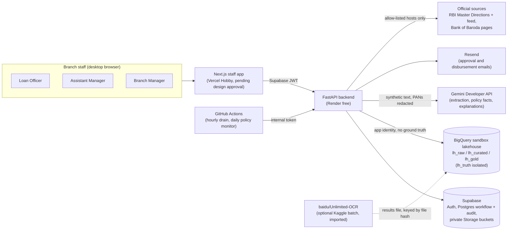
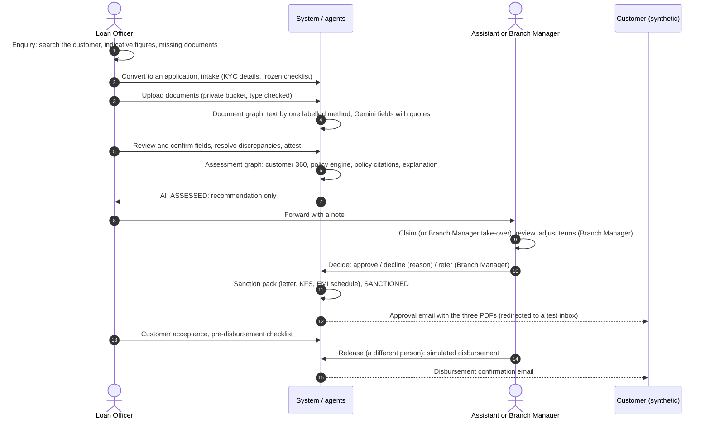
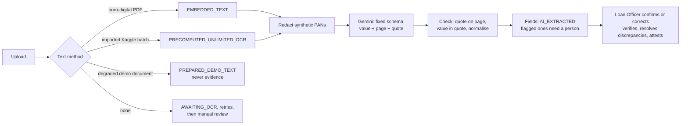
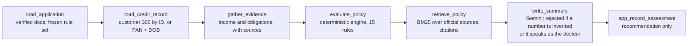
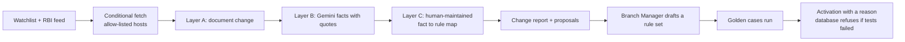

# Architecture

Baroda Lending Desk (Demo) is an agentic loan-processing demo for the standard Baroda Personal Loan, built on synthetic data and free tiers only. The AI extracts, checks, retrieves policy and recommends. People decide, and the database enforces that.

## System context

- **The backend is the only client of the database, storage, BigQuery, Gemini and Resend.** The browser holds only the Supabase anon key and the user's JWT.
- **Roles and permissions** are read from the database on every request, never from token claims.
- **Ground truth:** `lh_truth` holds the generator's answers, used only for evaluation. The app and agent identities have no access to it, and a test proves this (18 checks).

## Lifecycle swimlane

**Statuses:** `INTAKE` → `DOCS_PENDING` ⇄ `DISCREPANCY` → `DOCS_VERIFIED` → `AI_ASSESSED` → `FORWARDED` → `UNDER_REVIEW` → `APPROVED` / `DECLINED` / `RECONSIDERATION` → `SANCTIONED` → `DISBURSED`. See [REQUIREMENTS.md](REQUIREMENTS.md#status-model) for who may make each move.

## Agent workflows

### Document graph (job runner)

### Assessment graph (LangGraph)

- **The recommendation comes from the engine alone:** `RECOMMENDED_FOR_APPROVAL`, `REFER_FOR_FURTHER_REVIEW` or `POTENTIALLY_INELIGIBLE`.
- **A missing credit history is never a failure.** Thin-file and new-to-credit applicants are assessed on the evidence that exists.

### Policy monitor (daily)

## Where things live

| Concern | Where |
|---|---|
| Workflow state, audit trail (append-only), human-only guards | Supabase Postgres (`supabase/migrations/0001`–`0014`) |
| Uploaded documents, sanction PDFs, policy source snapshots | Supabase Storage, three private buckets, 60-second signed URLs |
| Synthetic bank data, credit features, customer 360, OCR text, policy chunks and facts, analytics events and KPIs | BigQuery `lh_raw` → `lh_curated` → `lh_gold` ([DATA_MODEL.md](DATA_MODEL.md)) |
| Policy rules | Versioned rule sets in Supabase. Each application keeps the version frozen at its intake. |
| Scheduling | GitHub Actions: `jobs-drain.yml` (hourly), `policy-monitor.yml` (daily) |
| Secrets | Local `.env` (gitignored), Render environment, GitHub Actions secrets |
