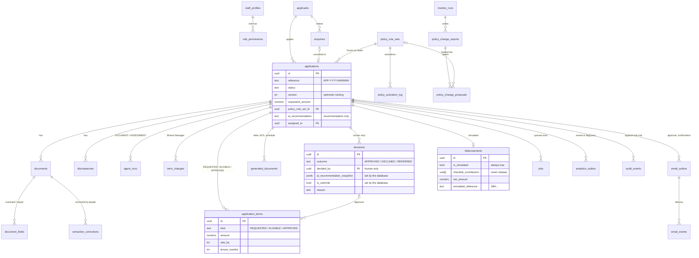

# Data model

Two stores, each holding what it is good at:
- **Supabase Postgres:** the workflow, people and audit, with transactions and human-only guards.
- **BigQuery:** the lakehouse, with synthetic bank data, documents' text, policy knowledge and analytics.

Everything is synthetic.

## Operational ERD (Supabase)

**Guards worth knowing** (all are database triggers, so they hold even if application code is wrong):
- **Workflow columns** change only through `app_transition`, `app_record_assessment`, `app_claim` and `app_take_over`.
- **Decisions:**
  - Only an active Assistant or Branch Manager holding the file can decide.
  - The database computes the AI snapshot and the override flag.
  - A decline, a referral or an override needs a reason.
- **Terms:**
  - `ELIGIBLE` terms come only from a finished assessment run, matched figure for figure.
  - `APPROVED` terms come only from the approving human, within the demo limits.
- **Documents:** only a person verifies them. A person's value is never overwritten. Prepared demo data is never evidence.
- **Sanction documents** need a human approval. **Disbursement** needs acceptance, a complete checklist and a different releasing person.
- **Rule sets** become `ACTIVE` only with `policy.activate`, a reason and passing golden cases. No value may be `UNVERIFIED_CANDIDATE`.
- **Append-only:** the audit trail, decisions, terms, term changes, generated documents, email events, analytics events, change reports and proposal evidence.
- **Browser roles:** row-level security denies them everything.

## Lakehouse layer map (BigQuery sandbox)

| Layer | Objects | Built by | Who reads it |
|---|---|---|---|
| `lh_raw` | Synthetic bank data: `customers`, `accounts`, `account_holders`, `transactions`, `branches`, `employment`, `existing_loans`, `loan_repayments`, `bureau_profiles`, `bureau_tradelines`, `ext_kyc_mock`, `historical_applications` | Generator and load jobs (`scripts/load_bigquery.py`) | App identity |
| `lh_raw` | Document text: `ocr_pages` (with `extraction_method`), `extraction_outputs` (PANs as placeholders), `prepared_demo_values` | Job runner (append grant); owner tools | App identity |
| `lh_raw` | Policy: `policy_sources` (versions, hashes, snapshot paths), `policy_chunks`, `policy_facts` | Policy monitor (append grant); seed ingest | App identity |
| `lh_raw` | `events` (the demo's decisions, status changes and simulated disbursements) | Analytics sync from the Supabase outbox (append grant) | App identity |
| `lh_curated` | `tradeline_dpd_24m`, `monthly_income_credits`, `credit_features` (tables); `policy_chunks`, `policy_facts_current`, `events` (views: latest version, de-duplicated) | `scripts/build_layers.py` (CTAS), views by the set-up scripts | App identity |
| `lh_gold` | `customer_360` (table); `policy_current`, `kpi_decisions_monthly`, `kpi_ai_vs_human`, `kpi_funnel_live`, `kpi_disbursements_live`, `kpi_portfolio`, `kpi_portfolio_dpd` (views) | `scripts/build_layers.py`, `scripts/setup_analytics.py` | App identity (lookup, assessment, analytics) |
| `lh_truth` | `customer_ground_truth`, `documents_truth`, `external_statement_lines` | Generator, for evaluation only | **Evaluation identity and owner only.** The app and agent identities are refused (`scripts/test_truth_isolation.py`, 18 checks). |

**Sandbox constraints:**
- There is no DML and no streaming, so rows are appended with load jobs and the curated and gold layers are rebuilt with `CREATE OR REPLACE`, or are views.
- Tables expire after 60 days, so everything can be rebuilt from the generator, the manifest and the scripts.
- Every query carries a bytes-billed cap.
