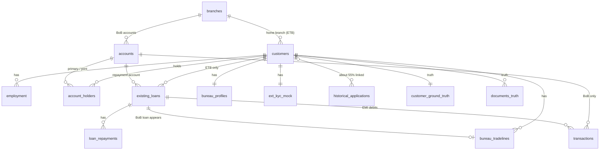

# Gate A: Synthetic Dataset Schema (for approval)

Status: **proposed, awaiting your approval. No data has been generated and Phase 4 has not started.**

All data is synthetic. No real customer, PAN, Aadhaar, account or bureau data is used. The generator is seeded and reproducible (`as_of_date = 2026-11-01`, history from 2025-11-01 to 2026-10-31).

## 1. Where the data lives

All tables load into the BigQuery sandbox through load jobs (no DML, no streaming).

| Dataset | Purpose | Read by the application? |
|---|---|---|
| `lh_raw` | The generated banking, bureau and KYC data as loaded | Yes, through curated and gold layers |
| `lh_truth` | Ground truth used only to build and test documents, and to validate the data | **Never read by agents or the app at runtime** |
| `lh_curated` | Typed, conformed tables and derived credit features (built from `lh_raw`) | Yes |
| `lh_gold` | `customer_360` and KPIs (built from `lh_curated`) | Yes |

BigQuery does not enforce primary or foreign keys. The keys below are enforced by the **validation suite** (section 7), which must pass before any load is accepted.

## 2. Segments and distribution

Two independent axes: **bank relationship** (ETB or NTB) and **credit history** (`ESTABLISHED`, `THIN`, `NO_HISTORY` = NTC).

| Segment code | Relationship | Credit history | Count |
|---|---|---|---|
| `ETB_EST` | ETB | Established | 440 |
| `ETB_THIN` | ETB | Thin | 80 |
| `ETB_NTC` | ETB | No history | 80 |
| `NTB_EST` | NTB | Established | 250 |
| `NTB_THIN` | NTB | Thin | 50 |
| `NTB_NTC` | NTB | No history | 100 |
| **Total** | | | **1,000** |

Totals: ETB 600, NTB 400. Established 690, thin 130, NTC 180.

**What each segment looks like in the data:**

| Segment | Bank accounts and transactions | Bureau |
|---|---|---|
| ETB (all) | At least one Bank of Baroda account with 12 months of transactions, `customer_since` set, home branch set | See below |
| NTB (all) | No Bank of Baroda account. Other-bank accounts only, with the statement lines held in `lh_truth` and used to build sample statement documents | See below |
| Established | n/a | 3–8 tradelines, score present (300–900), mixed repayment history |
| Thin | n/a | 1–2 tradelines, oldest under 12 months. Score present for about 60% of thin customers, otherwise null |
| No history (NTC) | n/a | Zero tradelines, score null |

**Search behaviour:** the Loan Officer's customer lookup searches **ETB customers only** (by customer ID, mobile, PAN or account number). An NTB person is not found, exactly like a real walk-in, and is registered as a new enquiry. NTB identity data exists in the dataset only to drive the mock bureau and KYC lookups (by PAN) and to generate their documents.

### Other attribute distributions (targets)

| Attribute | Target |
|---|---|
| Age | 21–62 mostly. A few edge cases below 21 and near the upper limit |
| Employment | Salaried private ~55%, government and PSU ~15%, self-employed professional or business ~25%, pensioner ~5% |
| Monthly net income | Log-normal, median about ₹45,000, range roughly ₹15,000–₹3,50,000 |
| Branch tier | Metro ~35%, urban ~30%, semi-urban ~20%, rural ~15% |
| Gender | M ~58%, F ~41%, O ~1% |
| Established bureau score | 750+ about 40%, 700–749 about 30%, 650–699 about 17%, below 650 about 13% |

## 3. Tables (`lh_raw`)

Types are BigQuery types. `PK` = unique key, `FK` = foreign key (validated, not enforced).

### 3.1 `branches` (about 40 rows)

| Field | Type | Notes |
|---|---|---|
| `branch_id` | STRING | PK, `BRN-001`… |
| `branch_name` | STRING | |
| `city`, `state` | STRING | |
| `pincode` | STRING | |
| `city_tier` | STRING | `METRO`, `URBAN`, `SEMI_URBAN`, `RURAL` |
| `ifsc_code` | STRING | Synthetic: `BARB0SYN` + 3 digits |

### 3.2 `customers` (1,000 rows)

| Field | Type | Notes |
|---|---|---|
| `customer_id` | STRING | PK, `CUST-0001`…`CUST-1000` (the synthetic demo identifier) |
| `bank_relationship` | STRING | `ETB` or `NTB` |
| `full_name` | STRING | |
| `date_of_birth` | DATE | |
| `gender` | STRING | `M`, `F`, `O` |
| `mobile` | STRING | 10 digits starting 6–9. Six deliberate duplicate pairs |
| `email` | STRING | Reserved domain `@example.invalid` |
| `pan` | STRING | Synthetic, format `AAAPA9999A`. Unique (see note) |
| `aadhaar_last4` | STRING | Last four digits only. Full Aadhaar is never stored |
| `address_line`, `city`, `state` | STRING | |
| `pincode` | STRING | |
| `residency_status` | STRING | `RESIDENT` or `NRI` |
| `is_staff` | BOOL | ETB only |
| `home_branch_id` | STRING | FK → `branches`. ETB only, null for NTB |
| `customer_since` | DATE | ETB only |
| `kyc_status` | STRING | `VERIFIED`, `EXPIRED`, `PENDING`, `NOT_APPLICABLE` (NTB) |
| `kyc_last_verified_on` | DATE | Null for NTB |

Note: a randomly generated PAN-format string could coincide with a real PAN. It does not identify a real person, and the format is unchecked beyond structure.

### 3.3 `employment` (about 1,300 rows)

One current row per customer, plus previous jobs for some.

| Field | Type | Notes |
|---|---|---|
| `employment_id` | STRING | PK |
| `customer_id` | STRING | FK → `customers` |
| `employment_type` | STRING | `SALARIED_PRIVATE`, `SALARIED_GOVT`, `SALARIED_PSU`, `SELF_EMPLOYED_PROFESSIONAL`, `SELF_EMPLOYED_BUSINESS`, `PENSIONER` |
| `employer_name` | STRING | |
| `employer_category` | STRING | `GOVT`, `PSU`, `MNC`, `LISTED`, `PRIVATE_LTD`, `PROPRIETORSHIP`, `OTHER` |
| `designation` | STRING | |
| `start_date` | DATE | |
| `end_date` | DATE | Null if current |
| `is_current` | BOOL | Exactly one true per customer |
| `declared_monthly_gross` | NUMERIC | INR |
| `declared_monthly_net` | NUMERIC | INR |

### 3.4 `accounts` (about 1,400 rows)

| Field | Type | Notes |
|---|---|---|
| `account_id` | STRING | PK, synthetic 12-digit |
| `institution_name` | STRING | `Bank of Baroda` or another bank |
| `is_bob` | BOOL | |
| `branch_id` | STRING | FK → `branches`. Bank of Baroda accounts only |
| `account_type` | STRING | `SAVINGS`, `SALARY`, `CURRENT`, `PENSION` |
| `opened_on` | DATE | |
| `status` | STRING | `ACTIVE`, `DORMANT`, `CLOSED` |
| `is_salary_account` | BOOL | |
| `current_balance` | NUMERIC | INR |
| `avg_balance_6m` | NUMERIC | INR |
| `currency` | STRING | `INR` |

### 3.5 `account_holders` (about 1,500 rows)

| Field | Type | Notes |
|---|---|---|
| `account_id` | STRING | FK → `accounts` (composite PK with `customer_id`) |
| `customer_id` | STRING | FK → `customers` |
| `holder_role` | STRING | `PRIMARY` or `JOINT` (about 8% of accounts are joint) |
| `relationship_since` | DATE | |

### 3.6 `transactions` (about 300,000–350,000 rows)

Bank of Baroda accounts only, 12 months.

| Field | Type | Notes |
|---|---|---|
| `txn_id` | STRING | PK |
| `account_id` | STRING | FK → `accounts` (`is_bob` must be true) |
| `txn_date` | DATE | |
| `amount` | NUMERIC | INR, always positive |
| `direction` | STRING | `CREDIT` or `DEBIT` |
| `category` | STRING | `SALARY`, `PENSION`, `BUSINESS_RECEIPT`, `TRANSFER_IN`, `TRANSFER_OUT`, `EMI`, `UPI`, `ATM`, `RENT`, `UTILITY`, `CARD`, `INVESTMENT`, `INTEREST`, `CHARGES`, `OTHER` |
| `channel` | STRING | `UPI`, `NEFT`, `IMPS`, `NACH`, `ATM`, `BRANCH`, `CARD`, `CHEQUE` |
| `narration` | STRING | |
| `counterparty` | STRING | Nullable |
| `txn_status` | STRING | `POSTED` or `RETURNED` (a bounced EMI debit) |
| `balance_after` | NUMERIC | INR |
| `loan_id` | STRING | FK → `existing_loans`. Set on EMI debits |

### 3.7 `existing_loans` (about 350 rows, Bank of Baroda loans only)

| Field | Type | Notes |
|---|---|---|
| `loan_id` | STRING | PK |
| `customer_id` | STRING | FK → `customers` (ETB only) |
| `product_type` | STRING | `PERSONAL`, `HOME`, `AUTO`, `EDUCATION`, `GOLD`, `CONSUMER_DURABLE` |
| `sanctioned_amount` | NUMERIC | INR |
| `outstanding_amount` | NUMERIC | INR |
| `emi_amount` | NUMERIC | INR |
| `interest_rate` | NUMERIC(5,2) | Percent |
| `tenure_months` | INT64 | |
| `start_date`, `maturity_date` | DATE | |
| `status` | STRING | `ACTIVE`, `CLOSED`, `OVERDUE`, `WRITTEN_OFF` |
| `repayment_account_id` | STRING | FK → `accounts` |

### 3.8 `loan_repayments` (about 7,000 rows)

| Field | Type | Notes |
|---|---|---|
| `repayment_id` | STRING | PK |
| `loan_id` | STRING | FK → `existing_loans` |
| `due_date` | DATE | |
| `due_amount` | NUMERIC | INR |
| `paid_date` | DATE | Null if missed |
| `paid_amount` | NUMERIC | Null if missed |
| `days_past_due` | INT64 | |
| `status` | STRING | `PAID_ON_TIME`, `PAID_LATE`, `PARTIAL`, `MISSED` |

### 3.9 `bureau_profiles` (1,000 rows, mock bureau)

| Field | Type | Notes |
|---|---|---|
| `customer_id` | STRING | PK, FK → `customers` |
| `bureau_name` | STRING | `MOCK_CIBIL` |
| `history_status` | STRING | `ESTABLISHED`, `THIN`, `NO_HISTORY` |
| `score` | INT64 | 300–900. **Null for NO_HISTORY and for about 40% of THIN** |
| `score_date` | DATE | Null if no score |
| `tradeline_count` | INT64 | |
| `active_tradeline_count` | INT64 | |
| `oldest_tradeline_date` | DATE | Null for NO_HISTORY |
| `total_outstanding` | NUMERIC | INR |
| `total_monthly_emi` | NUMERIC | INR |
| `enquiries_last_6m` | INT64 | |
| `max_dpd_last_12m` | INT64 | Null for NO_HISTORY |
| `has_written_off`, `has_settled` | BOOL | |
| `report_date` | DATE | |

### 3.10 `bureau_tradelines` (about 3,000 rows)

| Field | Type | Notes |
|---|---|---|
| `tradeline_id` | STRING | PK |
| `customer_id` | STRING | FK → `customers` |
| `lender_name` | STRING | |
| `lender_type` | STRING | `PSU_BANK`, `PRIVATE_BANK`, `NBFC`, `FINTECH`, `CARD_ISSUER` |
| `is_bob` | BOOL | |
| `existing_loan_id` | STRING | FK → `existing_loans` (Bank of Baroda loans only) |
| `account_type` | STRING | `PERSONAL_LOAN`, `HOME_LOAN`, `AUTO_LOAN`, `GOLD_LOAN`, `CREDIT_CARD`, `CONSUMER_LOAN`, `EDUCATION_LOAN`, `OVERDRAFT` |
| `ownership` | STRING | `INDIVIDUAL` or `JOINT` |
| `opened_date` | DATE | |
| `closed_date` | DATE | Nullable |
| `sanctioned_amount` | NUMERIC | Nullable |
| `credit_limit` | NUMERIC | Cards only |
| `current_balance` | NUMERIC | INR |
| `emi_amount` | NUMERIC | Nullable |
| `status` | STRING | `ACTIVE`, `CLOSED`, `OVERDUE`, `WRITTEN_OFF`, `SETTLED` |
| `max_dpd` | INT64 | |
| `monthly_dpd_24m` | ARRAY<INT64> | Last 24 months |

### 3.11 `historical_applications` (about 2,000 rows)

Past Personal Loan applications and outcomes, used for analytics baselines and as realistic history.

| Field | Type | Notes |
|---|---|---|
| `application_id` | STRING | PK |
| `customer_id` | STRING | FK → `customers`. About 55% linked (ETB), the rest null |
| `applicant_ref` | STRING | Anonymous reference when there is no customer link |
| `scheme` | STRING | `BARODA_PERSONAL_LOAN` |
| `application_date` | DATE | |
| `channel` | STRING | `BRANCH`, `ONLINE_LEAD`, `DSA` |
| `relationship_at_application` | STRING | `ETB`, `NTB` |
| `history_status_at_application` | STRING | `ESTABLISHED`, `THIN`, `NO_HISTORY` |
| `requested_amount` | NUMERIC | INR |
| `requested_tenure_months` | INT64 | |
| `approved_amount` | NUMERIC | Null if not approved |
| `approved_rate` | NUMERIC(5,2) | Null if not approved. Synthetic, not Bank of Baroda's |
| `approved_tenure_months` | INT64 | |
| `outcome` | STRING | `APPROVED`, `DECLINED`, `WITHDRAWN` |
| `decline_reason_code` | STRING | `FOIR_EXCEEDED`, `INCOME_NOT_VERIFIED`, `ADVERSE_REPAYMENT`, `AGE_OUT_OF_RANGE`, `DOCUMENT_ISSUES`, `OTHER` |
| `decision_date` | DATE | |
| `processing_days` | INT64 | Turnaround |
| `decided_by_role` | STRING | `ASSISTANT_MANAGER` or `BRANCH_MANAGER` |

### 3.12 `ext_kyc_mock` (1,000 rows, mock KYC/PAN service)

| Field | Type | Notes |
|---|---|---|
| `customer_id` | STRING | PK, FK → `customers` |
| `pan` | STRING | |
| `pan_status` | STRING | `VALID`, `INVALID`, `NOT_FOUND`, `DEACTIVATED` |
| `pan_name_on_record` | STRING | |
| `name_match_score` | NUMERIC(3,2) | 0.00–1.00 |
| `aadhaar_check` | STRING | `VERIFIED`, `MISMATCH`, `NOT_CHECKED` |
| `address_match` | BOOL | |
| `checked_at` | TIMESTAMP | |

### 3.13 `dataset_versions` (one row per generation)

| Field | Type | Notes |
|---|---|---|
| `dataset_version` | STRING | PK |
| `seed` | INT64 | |
| `generator_version` | STRING | |
| `generated_at` | TIMESTAMP | |
| `manifest_sha256` | STRING | |
| `row_counts` | JSON | |

## 4. Ground-truth tables (`lh_truth`, never read at runtime)

### 4.1 `customer_ground_truth` (1,000 rows)

| Field | Type | Notes |
|---|---|---|
| `customer_id` | STRING | PK, FK → `customers` |
| `segment_code` | STRING | One of the six codes in section 2 |
| `edge_case_tags` | ARRAY<STRING> | See section 6 |
| `persona_notes` | STRING | Short description for demo scripting |

### 4.2 `external_statement_lines` (about 60,000 rows)

Other-bank statement lines for NTB customers, used only to build statement documents and to check OCR and extraction accuracy.

| Field | Type |
|---|---|
| `line_id` | STRING (PK) |
| `customer_id` | STRING (FK) |
| `account_id` | STRING (FK → `accounts`, `is_bob` false) |
| `statement_month` | DATE |
| `txn_date` | DATE |
| `amount` | NUMERIC |
| `direction` | STRING |
| `category` | STRING |
| `narration` | STRING |
| `balance_after` | NUMERIC |

### 4.3 `documents_truth` (about 480 rows, for about 120 customers, 20 per segment)

| Field | Type | Notes |
|---|---|---|
| `doc_id` | STRING | PK |
| `customer_id` | STRING | FK |
| `doc_type` | STRING | `PAN_CARD`, `AADHAAR_MASKED`, `SALARY_SLIP`, `BANK_STATEMENT`, `ITR` |
| `period` | STRING | e.g. `2026-05` or `2026-05..2026-10` |
| `page_count` | INT64 | |
| `quality` | STRING | `CLEAN`, `SKEWED`, `LOW_RES`, `SCANNED_NOISE` |
| `expected_fields` | JSON | The exact values a correct extraction must return |
| `injected_discrepancy` | STRING | `NONE`, `NAME_VARIANT`, `INCOME_MISMATCH`, `DOB_MISMATCH`, `PAN_TYPO` |
| `file_name` | STRING | |

The generated PDFs and images are written locally, are **not committed**, and are used for Gate C, OCR accuracy checks and the demo packets.

## 5. Relationships

## 6. Edge cases (target counts, exact counts fixed in the manifest)

| Area | Edge case | Approx. count |
|---|---|---|
| Thin file | One tradeline of about 8 months | 30 |
| Thin file | Credit card only | 25 |
| Thin file | Closed loan only | 15 |
| Thin file | A DPD event inside a thin file | 15 |
| Thin file | Recently opened secured card | 15 |
| Thin file | ETB whose only history is a Bank of Baroda loan | 10 |
| NTC | Young first-job salaried, stable salary credits | 60 |
| NTC | Self-employed with irregular receipts | 40 |
| NTC | Pensioner or other, no borrowing history | 30 |
| Income | Irregular or missing salary months | 70 |
| Income | Declared income differs from statement by more than 15% | 80 |
| Income | Current job under 1 year | 90 |
| Repayment | Bounced or returned EMI debits | 25 |
| Repayment | Late payments (DPD 30+) in established files | 80 |
| Repayment | Written-off or settled tradeline | 15 |
| Identity | Name variant between documents and records | 50 |
| Identity | Duplicate mobile number | 12 (6 pairs) |
| Identity | KYC expired or pending (ETB) | 30 |
| Eligibility | Age under 21 | 8 |
| Eligibility | Age near the upper limit (57–62) | 25 |
| Eligibility | Borderline FOIR | 60 |
| Flags | `is_staff` (ETB only) | 20 |
| Flags | `residency_status = NRI` | 30 (12 ETB, 18 NTB) |
| Accounts | Dormant account | 30 |
| Accounts | Government salary account at Bank of Baroda | 50 |
| Accounts | Joint account | 8% of accounts |
| Branch | Rural and semi-urban home branch | about 35% of ETB |

Edge cases overlap (one customer can carry several tags). Counts are targets, and the generator records the actual figures.

## 7. Validation suite (must pass before a load is accepted)

**Counts and distribution**
1. Row counts match the manifest.
2. Segment counts equal the table in section 2 exactly, including **THIN: 80 ETB and 50 NTB** and NTC 80 ETB and 100 NTB.
3. All three history states appear under both ETB and NTB.

**Keys and relationships**
4. Every primary key is unique and non-null.
5. Every foreign key resolves (customer, account, branch, loan, repayment).
6. Transactions reference only Bank of Baroda accounts. EMI debits link to a loan.
7. Bank of Baroda loans appear in both `existing_loans` and `bureau_tradelines` with matching amounts.
8. Each customer has exactly one current employment row, exactly one bureau profile and one KYC row.

**Segment rules**
9. ETB customers have at least one Bank of Baroda account, a branch and a `customer_since`. NTB customers have no Bank of Baroda account.
10. NTC: zero tradelines, `score` null, `max_dpd_last_12m` null.
11. Thin: 1–2 tradelines, oldest under 12 months, and a score for the defined share. **No thin customer has zero tradelines and no NTC has any.**
12. Established: 3–8 tradelines and a score.
13. `customer_ground_truth.segment_code` agrees with `bank_relationship` and `bureau_profiles.history_status`.

**Realism**
14. Salary credits reconcile with `employment`. Account balances never go inconsistent (`balance_after` arithmetic holds).
15. Paid repayments reconcile with EMI debits within a tolerance.
16. Age, tenure, dates and amounts are within plausible ranges. No full Aadhaar numbers anywhere.

**Reproducibility**
17. Two runs with the same seed produce identical checksums.

## 8. Derived layers (built from the raw tables by CREATE TABLE AS SELECT)

**`lh_curated.credit_features`** (one row per customer): `age_years`, `current_job_tenure_months`, `declared_net_income`, `avg_salary_credit_6m`, `salary_credit_months_6m`, `salary_regularity` (coefficient of variation), `avg_balance_6m`, `bob_account_age_months`, `bob_emi_total`, `bureau_emi_total`, `total_monthly_obligations`, `bureau_score`, `tradeline_count`, `oldest_tradeline_age_months`, `max_dpd_12m`, `late_payments_24m`, `returned_debits_6m`.

**`lh_gold.customer_360`**: identity, relationship, history status, KYC status, flags, plus the features above. Bank-held columns (accounts, salary credits, loans) are populated for **ETB only**. NTB rows carry identity, bureau and KYC data only, and are not searchable by the ETB lookup.

Other curated and gold tables (OCR pages, policy documents, facts, chunks, change reports, decision events, KPIs) are defined with their phases.

## 9. Size and cost check

Estimated load size is about 100–150 MB. The BigQuery sandbox allows 10 GiB of **lifetime** storage that is not refunded when data is deleted, so the plan caps full reloads at a deliberate handful (a reload counter is kept in `dataset_versions`). Tables also expire after 60 days, so the dataset is rebuilt from the seed.

## 10. What I need from you

1. **Approve or amend** the segment distribution (section 2), the tables and fields (sections 3 and 4), and the validation suite (section 7).
2. **Refinement to confirm:** the plan listed `credit_history_status` on `customers`. Here the history state lives in `bureau_profiles` (what the app can see) and in `customer_ground_truth` (test truth), so the app never reads a pre-labelled segment. Is that acceptable?
3. **Optional documents:** do you want the `documents_truth` table and generated sample documents (about 120 customers) in this dataset? They support Gate C, OCR accuracy checks and demo packets.
