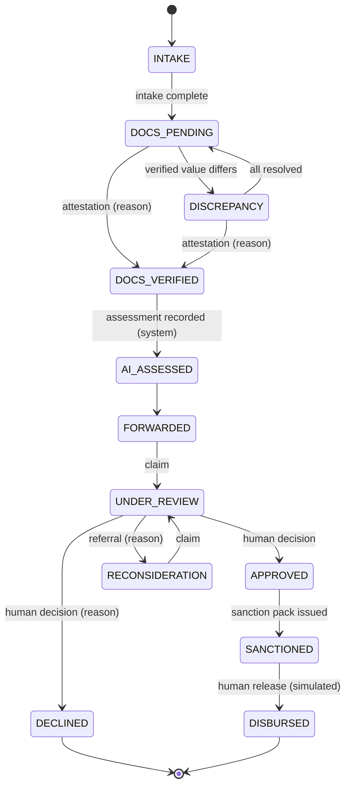

# Requirements pack

Product: the standard Baroda Personal Loan, demo only. Every figure is a `DEMO_ASSUMPTION` unless it is marked `VERIFIED` against an official source. Every customer and document is synthetic.

## Roles

| Role | Purpose |
|---|---|
| Loan Officer | Enquiries, intake, documents, discrepancies, forwarding, disbursement tracking. Never approves or declines. |
| Assistant Manager | Reviews and decides (approve or decline). Releases simulated disbursements (demo permission). |
| Branch Manager | Everything the Assistant Manager does, plus take-over, referral for reconsideration, term adjustment within demo limits, and policy activation (demo permission). |
| System and agents | Extraction, checks, assessment, sanction documents, emails, monitoring. Never decide, never change rules, terms or decisions. |

## User stories and acceptance criteria

**Loan Officer**
1. *As a Loan Officer, I look up a customer by ID, mobile, PAN, account number or name, so that I can prefill an enquiry.*
   - Only existing customers are found.
   - Bureau and external KYC data are not shown at this stage.
2. *As a Loan Officer, I give an indicative amount, rate, tenure and missing-documents list, so that the customer knows what to bring.*
   - Labelled "indicative, not a loan offer".
   - No AI, bureau pull or approval workflow is involved.
3. *As a Loan Officer, I convert an enquiry, complete intake and upload documents, so that the application can be assessed.*
   - The checklist is frozen at intake from the active rule set.
   - Uploads are type-checked from the file's own bytes, at most 10 MB, never overwritten, and never deleted (only withdrawn with a reason).
4. *As a Loan Officer, I review extracted fields beside the page text, so that only values I have confirmed become evidence.*
   - Every value shows how it was read.
   - A flagged value must be confirmed before the document can be verified.
   - Prepared demo data can never be verified until it is re-keyed.
5. *As a Loan Officer, I resolve discrepancies and attest that the documents are complete, so that the assessment can run.*
   - The database checks that the attestation is true: every checklist item verified, nothing processing, nothing open.
6. *As a Loan Officer, I forward an assessed application with a note, so that a reviewer can decide.*
7. *As a Loan Officer, I record the customer's acceptance and the pre-disbursement checklist, so that a manager can release.*
   - After the KFS validity, a reason is required.
   - All four checklist items are needed.
   - Whoever worked on the checklist cannot release.

**Assistant Manager**
1. *As an Assistant Manager, I see a review queue and claim a file, so that one reviewer owns it.*
   - Only one reviewer gets a concurrent claim.
2. *As an Assistant Manager, I read the AI recommendation with rule-by-rule results and policy citations, so that I can decide on evidence.*
   - Labelled "AI recommendation, human decides".
3. *As an Assistant Manager, I approve exactly the terms I saw, or decline with a reason, so that the decision is recorded and audited.*
   - Overriding the AI needs a written reason and writes `DECISION_OVERRIDE`.
   - If the terms changed since I opened the file, the approval is refused.
4. *As an Assistant Manager, I release a simulated disbursement, so that the customer receives the confirmation.*
   - Maker-checker applies.
   - No real transaction happens.
5. *As an Assistant Manager, I view analytics and system health, so that I can see the pipeline and any stuck work.*

**Branch Manager**
1. *As a Branch Manager, I take over another reviewer's file with a reason.* It is audited as `APPLICATION_TAKEOVER`.
2. *As a Branch Manager, I adjust amount, rate or tenure within the demo limits with a reason.*
   - The database checks the band, the range and the cap.
   - With no eligible amount, the cap is the requested amount.
3. *As a Branch Manager, I refer an application for reconsideration with a note.* It returns to the queue for any reviewer.
4. *As a Branch Manager, I review policy change reports and proposals, draft a candidate rule set, see the golden-case results, and activate it with a reason.*
   - The database refuses activation if the tests failed.
   - In-flight applications keep their version.

## Permissions matrix

`FIXED` permissions are protected by database constraints. `CONFIGURABLE` ones are demo permissions, **not Bank of Baroda's actual authorization structure**, and are labelled so wherever they appear.

| Permission | Loan Officer | Assistant Manager | Branch Manager | Kind |
|---|:-:|:-:|:-:|---|
| `enquiry.manage` (create, edit, convert, close) | ✔ | | | FIXED |
| `enquiry.view` | | ✔ | ✔ | FIXED |
| `application.view` | ✔ | ✔ | ✔ | FIXED |
| `application.intake` (intake, uploads) | ✔ | | | FIXED |
| `document.verify` (fields, verify, discrepancies, attest) | ✔ | | | FIXED |
| `application.forward` | ✔ | | | FIXED |
| `assessment.view` | ✔ | ✔ | ✔ | FIXED |
| `decision.make` (claim, approve, decline) | | ✔ | ✔ | FIXED |
| `application.takeover` | | | ✔ | FIXED |
| `application.refer` | | | ✔ | FIXED |
| `terms.adjust` | | | ✔ | FIXED |
| `disbursement.track` (acceptance, checklist) | ✔ | | | CONFIGURABLE |
| `disbursement.release` | | ✔ | ✔ | CONFIGURABLE |
| `disbursement.view` | ✔ | ✔ | ✔ | FIXED |
| `policy.view` | ✔ | ✔ | ✔ | FIXED |
| `policy.activate` (review reports, draft and activate rule sets) | | | ✔ | CONFIGURABLE |
| `analytics.view` | | ✔ | ✔ | FIXED |
| `system.view` (health, analytics sync and retry) | | ✔ | ✔ | FIXED |
| `audit.view` | ✔ | ✔ | ✔ | FIXED |

Database invariants hold whatever the configuration:
- Only an Assistant or Branch Manager can ever hold `decision.make`.
- Only a Branch Manager can hold take-over, referral and term adjustment.

## Status model

| From | To | Who | Permission | Reason | Precondition, checked in the database |
|---|---|---|---|:-:|---|
| INTAKE | DOCS_PENDING | staff or system | `application.intake` | | Intake complete (contact, KYC details, frozen checklist) |
| DOCS_PENDING | DISCREPANCY | staff or system | `document.verify` | | |
| DISCREPANCY | DOCS_PENDING | staff | `document.verify` | | No open discrepancy |
| DOCS_PENDING / DISCREPANCY | DOCS_VERIFIED | staff | `document.verify` | ✔ | Every checklist item has a verified document; nothing processing; nothing open |
| DOCS_VERIFIED | AI_ASSESSED | system only | | | A finished assessment run with the same recommendation |
| AI_ASSESSED | FORWARDED | staff | `application.forward` | | |
| FORWARDED / RECONSIDERATION | UNDER_REVIEW | staff | `decision.make` | | Assigned to the claimer |
| UNDER_REVIEW | APPROVED | staff | `decision.make` | override only | A human decision by the reviewer holding the file |
| UNDER_REVIEW | DECLINED | staff | `decision.make` | ✔ | As above |
| UNDER_REVIEW | RECONSIDERATION | staff | `application.refer` | ✔ | As above |
| APPROVED | SANCTIONED | staff or system | `decision.make` | | A human APPROVED decision; the letter, KFS and schedule exist |
| SANCTIONED | DISBURSED | staff | `disbursement.release` | | A released simulated disbursement (acceptance, checklist, maker-checker) |

Every transition carries the application version (a stale screen gets 409) and writes a `STATUS_TRANSITION` audit event and an analytics event.

## Non-functional requirements

- **Cost:** ₹0. Free tiers only, with daily budgets for Gemini (200), Resend (80) and uploads (300, and 150 per account). Every BigQuery query has a bytes cap.
- **Security:**
  - Supabase JWTs are verified against JWKS, with asymmetric algorithms only, and the role is read from the database.
  - Row-level security denies everything by default, and the browser roles get no tables.
  - Storage buckets are private.
  - The policy monitor fetches only from allow-listed hosts.
  - Security headers are on every response, and the API docs are off in production.
- **Privacy:** synthetic data only. Synthetic PANs never reach an external service (Gemini sees placeholders; the sanction pack and emails carry no PAN or mobile number). All email goes to a test inbox.
- **Auditability:** the audit trail, decisions, terms, sanction documents, email events and analytics events are append-only, enforced by database triggers.
- **Desktop and laptop only.** Phones and tablets are blocked in the frontend.
